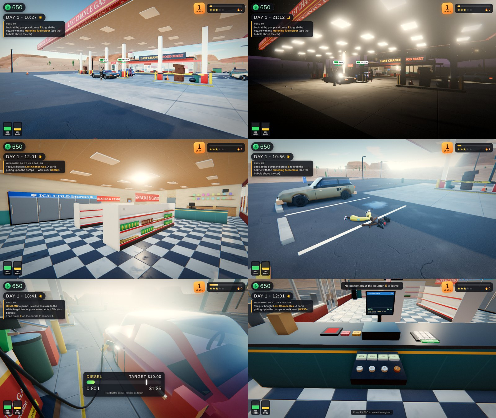

# ⛽ Last Chance Gas — Roadside Tycoon



A first-person gas station tycoon for the browser, built for **CrazyGames** (HTML5 SDK v3).
You run a dusty roadside station in the desert: pump fuel, ring up customers, restock the
shelves, mop up oil spills (or don't), and upgrade a run-down station into a highway legend.
Customers slip, trip, bonk into doors, get hit by tumbleweeds and dust devils, and **ragdoll**.

The game starts straight into gameplay after loading. There's no title menu: the only
overlays are the pause menu (Esc), the station tablet (Tab) and the end-of-day summary.

## Features

- **Rendering (three.js r187):** PBR materials with generated textures and anti-tiling, a
  Preetham sky with clouds and a full day/night cycle, a PMREM environment that follows the
  time of day, sun shadows that follow the player, GTAO ambient occlusion, HDR bloom, ACES
  tone mapping, colour grading, film grain, stars and moon, neon signs, glowing canopy lights,
  and a moving headlight wash at night.
- **Living station:** procedural cars (sedan, hatch, SUV, pickup, muscle, van, wagon, sports)
  lofted from profile curves, with clear-coat paint, dust, spinning and steering wheels,
  plates, lights and fuel doors. Highway traffic, a delivery box truck and a fuel tanker also
  drive through.
- **Characters:** rigged humans with Mixamo animations retargeted at load time
  (idle/walk/run/dance/nod/head-shake), plus **cannon-es ragdolls** with a get-up blend back
  to animation.
- **Gameplay loops:**
  - **Fuelling:** match the fuel colour, insert the nozzle into the fuel cap, and hold to
    pump. Release on the target line for a PERFECT FILL tip. Putting in the wrong fuel makes
    the car backfire. Leave the nozzle in and the customer drives off with it.
  - **Register:** click items to scan them, count change from the cash drawer, or key in card
    amounts.
  - **Stock:** order boxes on the tablet, a truck drops them by the side door, carry them in
    and stock the fridge, snack aisle or auto wall. Throw empty boxes in the dumpster.
  - **Cleaning:** mop oil and soda spills and pick up litter. Cleanliness affects reputation.
  - **Shoplifters:** tackle them with F to get the goods back.
- **Progression:** money, XP and levels, reputation stars, hype ("going viral" from funny
  moments), 18 upgrades (pump islands, premium fuel, high-flow and auto-stop nozzles, car
  wash, coffee, hot dogs, radio, neon sign, cameras, and staff: cashier, janitor, stock
  clerk, pump attendant), adjustable prices, fuel tanks, daily wages and bills, and
  dust-storm days.
- **Funny-moment director:** oil slicks, banana peels, jammed doors, phone zombies walking
  into poles, tumbleweeds, dust devils, dance-offs near the radio and a snack-stealing fox.
  Each one triggers a slow-mo "📸 LOL" moment and adds hype.
- **Audio:** fully procedural WebAudio. Engines, pump motor, register, door chime, footsteps
  per surface, gibberish voices, slide-whistle slips, desert wind, crickets at night, and a
  generative country/lo-fi radio.
- **Platform:** desktop (pointer lock) and mobile (virtual joystick plus buttons), automatic
  quality detection and dynamic resolution.

## Controls

| Action | Desktop | Mobile |
| --- | --- | --- |
| Move / look | WASD + mouse | Joystick + drag |
| Sprint / jump | Shift / Space | Push stick fully / ⤒ |
| Interact, pick up, hang up nozzle, use register | E (hold E to mop) | E |
| Use (insert nozzle, pump, stock shelf) | Left mouse | USE |
| Throw held item | Right mouse | ⤴ |
| Drop item / let the hose retract | Q | — |
| Shove (customers, fox, jammed door) | F | ✋ |
| Station tablet | Tab | ▦ |
| Pause | Esc / P | ❚❚ |

At the register: click items to scan them. For cash, click bills and coins to build the change
and then press GIVE. For card, type the amount on the keypad (keyboard digits and Enter also
work).

## CrazyGames SDK integration (`src/core/sdk.js`)

- `SDK.init()` runs at boot, and the game also works when the SDK is blocked or offline.
- `loadingStart` / `loadingStop` wrap asset loading.
- `gameplayStart` / `gameplayStop` follow pointer lock, pause, the day summary and ads.
- `happytime()` fires on level-up and on a profitable day.
- A **midgame ad** plays between days ("Start next day"). Audio is muted and gameplay stopped
  while it runs.
- **Rewarded ads:** double the day's tips, instant stock delivery, and free emergency fuel.
- Progress is saved with the **SDK data module** (`SDK.data`), falling back to `localStorage`.
- The game respects the platform mute setting (`addSettingsChangeListener`).
- There are no external links, no external fonts, and all assets use relative paths.

## Develop & build

```bash
npm install
npm run dev            # http://localhost:5173
npm run build:single   # ONE self-contained file (see below)
```

`npm run build:single` produces a **single file** with the JS, CSS, every texture (WebP)
and every model embedded. Nothing else needs to be uploaded:

- `dist-single/index.html` (about 8 MB). Upload this one file to CrazyGames (it includes
  the SDK v3 script tag).
- `dist-single/last-chance-gas.zip` is the same file zipped. The zip contains only
  `index.html`.
- `artifact/last-chance-gas.html` is the same game without the SDK tag, for hosting as a
  Claude Artifact.

Don't upload the source `index.html` from the repo root. It points at `./src/` and the
`./assets/` folder, and on its own it renders as unstyled text.

`npm run build` still makes the classic multi-file build in `dist/`, if you prefer that
(upload the whole folder). Models use quantized geometry rather than a WebAssembly decoder,
so they load in strict sandboxes. Asset pipelines:

- `scripts/gen_textures.py` regenerates every PBR texture procedurally (numpy + Pillow).
- `scripts/fetch-assets.sh` re-downloads and re-optimises the 3D models (gltf-transform).

## Project layout

```
src/core      input, procedural audio, CrazyGames SDK wrapper, saves, utils
src/gfx       renderer + post FX, sky/day-night, materials, textures, particles
src/world     terrain & road, station, shop interior, colliders, nav grid
src/physics   cannon-es world, ragdolls
src/entities  characters (retargeting), customers AI, cars, traffic, player, animals
src/game      fuel, register, inventory, deliveries, props, cleaning, economy, upgrades, funny events, tutorial, game loop
src/ui        HUD, world labels, tablet
```

See [CREDITS.md](CREDITS.md) for third-party assets and licences.
